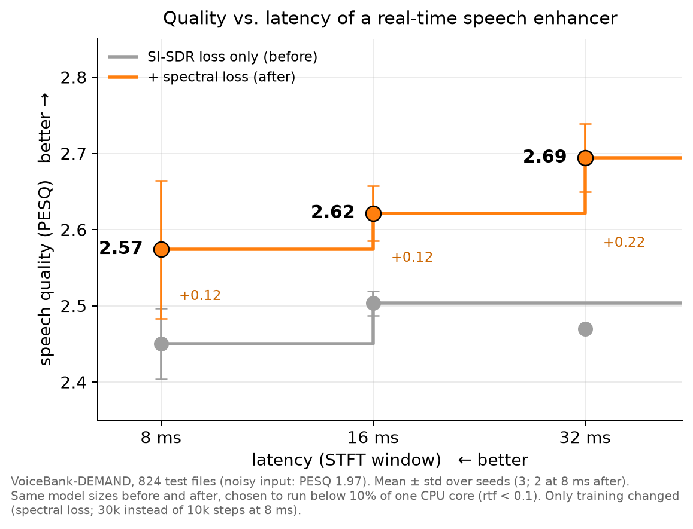

# Agentic Audio Lab

**How much speech quality does each millisecond of latency cost?** This repo answers that question for a small, real-time speech enhancer, using an LLM agent that plans, runs, diagnoses and reports the experiments on cloud GPUs.

## The question

Speech enhancement in earbuds and hearing devices has two hard limits:

- **Algorithmic latency.** In transparency or conversation modes, the processed sound has to reach the ear within roughly 10 ms, or the wearer hears an echo of their own voice. Many enhancement models use a 32 ms STFT window, so they cannot run there.
- **Compute.** The model runs on a small processor. Here the budget is a real-time factor below 0.1 on one CPU thread, so the model takes at most 10% of the time it processes.

Shrinking the window lowers latency but also frequency resolution, and smaller hops raise quality but also compute. Which configuration is best at 8, 16 and 32 ms is an empirical question. Answering it means running a grid of window, hop and model sizes, repeating the promising ones over seeds, and deciding what is a real difference and what is noise. That is the repetitive work the agent does.

## Answer



*Each line is a Pareto front: the best quality available at or below a given latency. Grey: the best models from study 1, trained with SI-SDR only. Orange: the same models after study 2 changed only their training. Plot: `python scripts/plot_pareto.py`.*

| Latency | Model (rtf < 0.1) | Study 1: SI-SDR loss | Study 2: + spectral loss | Gain |
|---|---|---|---|---|
| 8 ms | hop 2 ms, 1 GRU layer × 128 | 2.450 ± 0.047 | **2.574 ± 0.091** (2 seeds, 30k steps) | +0.12 |
| 16 ms | hop 4 ms, 2 layers × 256 | 2.503 ± 0.016 | **2.621 ± 0.036** | +0.12 |
| 32 ms | hop 8 ms, 2 layers × 256 | 2.470 ± 0.003 | **2.694 ± 0.045** | +0.22 |

PESQ (wideband) on the full VoiceBank-DEMAND test set (824 files; the noisy input scores 1.97), mean ± std over 3 seeds unless noted.

**What the agent found:**

1. **Study 1, the architecture** ([report](results/latency/report.md), 20 runs):
   - **The hop size matters more than the window.** At 16 ms a 4 ms hop beat an 8 ms hop by 0.08 PESQ. At 8 ms a 2 ms hop beat a 4 ms hop by 0.12. GRU width barely mattered.
   - **At 8 ms, compute is the limit.** Each GRU layer costs about 0.1 ms per frame whatever its width, so at a 2 ms hop only one layer fits the budget.
   - **With SI-SDR training, 32 ms was no better than 16 ms.** The agent noticed that SI-SDR kept improving with latency while PESQ did not, and suggested the loss as the next lever.
2. **Study 2, the training** ([report](results/objective/report.md), 24 runs):
   - **Adding a compressed multi-resolution spectral loss raised PESQ on every budget**, with no change to the models or their inference cost.
   - **The weight mattered.** PESQ kept rising up to the largest weight tried. The weight range I suggested (5 to 50) was too low; the agent found this by bracketing upward.
   - **Compressed input features and a cosine schedule did nothing.** The small 8 ms model needed the spectral loss *and* 3× longer training; either alone did not help.
   - **With the better loss, latency now buys quality: 8 → 16 → 32 ms gives 2.57 → 2.62 → 2.69.** At 16 and 32 ms every new seed beats every old seed. The 8 ms gain rests on 2 seeds, because one run was preempted.

**Open points the agent listed:**
- a third seed at 8 ms;
- testing larger loss weights with seeds (one seed at weight 1000 reached 2.78 at 32 ms);
- re-timing the 16 ms model on an idle machine, because it sits close to the rtf limit.

All runs with their hypotheses: [study 1](results/latency/runs.csv), [study 2](results/objective/runs.csv). The agent's tool calls are in [study 1](results/latency/agent_transcript.txt) and [study 2](results/objective/agent_transcript.txt).

## How the agent works

```
you: goal, budget ──► agent (Claude, tool-use loop) ──► tools ──► training runs on Modal GPUs (up to 4 in parallel)
                        ▲                                  │
                        └──── status, logs, metrics ◄──────┘          ──► report + trade-off plot
```

| Tool | What it does |
|---|---|
| `list_runs` | runs of the study with state, PESQ, latency, rtf; budget and free parallel slots |
| `launch_run` | starts a run from the base config plus overrides, with the hypothesis it tests |
| `wait_for_run`, `get_run_status` | block until a run ends; read its log tail to diagnose failures |
| `compare_runs` | metrics against a reference, and configurations pooled over seeds (mean, std) |
| `plot_tradeoff` | the plot above |
| `write_report` | the final Markdown report |

**Safeguards:**
- **Human approval:** every launch shows the overrides and the hypothesis and waits for `y`. The latency study ran with `--auto-approve` within a fixed budget.
- **Whitelist:** only listed config keys can change, within fixed ranges. Invalid STFT setups (hop above half the window) are rejected.
- **Budget:** a hard cap on launches and on parallel runs.
- **Failures surface:** NaN losses, crashed processes and remote errors show up as `failed` or `crashed`, with the error and the log tail.

**What went wrong during the study, and who fixed it:**
- **Rate limit:** 4 of 20 launches hit Modal's app-creation rate limit when 4 runs started at once.
- **Preemption:** three runs across both studies were preempted by the platform.
- **The agent's response:** it diagnosed every case as an infrastructure failure rather than a bad config, relaunched the runs it needed, and chose not to relaunch one that no longer mattered for the answer.
- **My fix:** during the study I added a retry with backoff for the rate limit.
- **An earlier bug:** in an earlier round, a race condition let the agent see a finished run before its metrics had arrived. The agent noticed the missing metrics and refused to draw conclusions from that run. I then fixed the race.

**Why seeds matter:** a first hyperparameter round with one seed per run produced PESQ swings of about ±0.05 that did not follow any pattern. The agent flagged this in its report. That is why the study requires at least 2 seeds before a difference counts as real.

## Setup

- **Model:** a causal GRU that predicts a spectral mask frame by frame (`audiolab/model.py`), so it can run as a stream: one STFT frame in, one frame out. It is trained with an SI-SDR loss for 10k steps.
- **Data:** [VoiceBank-DEMAND](https://datashare.ed.ac.uk/handle/10283/2791) (CC BY 4.0), resampled to 16 kHz. It has 11,572 training and 824 test utterances.
- **Metrics:**

  | Metric | Meaning |
  |---|---|
  | PESQ (wb) | perceived speech quality, 1 to 4.5 |
  | STOI | intelligibility, 0 to 1 |
  | SI-SDR | scale-invariant signal-to-distortion ratio, dB |
  | algorithmic latency | one STFT window: n_fft / 16 kHz |
  | rtf | compute time per hop on one CPU thread, batch 1, divided by the hop duration |

```
agent/run_agent.py    tool-use loop (Anthropic SDK)
agent/tools.py        tools and safeguards
audiolab/train.py     one run: train, evaluate, write status.json / metrics.json
audiolab/remote.py    the same run on a Modal GPU, streaming the files back
audiolab/model.py     MaskGRU
audiolab/metrics.py   PESQ, STOI, SI-SDR, streaming latency
modal_app.py          Modal image, data volume, GPU function
configs/              baseline and latency-study configs
results/              Pareto plot; per study: the agent's report and plot, run table, agent transcript
scripts/plot_pareto.py  the Pareto plot, from the run tables
```

## Run it

On a [Modal](https://modal.com) GPU. The agent and the API key stay on your machine; only training runs remotely.

```bash
pip install -r requirements.txt && modal token new
modal run modal_app.py::data_app.prepare_data        # once: download and resample into a Modal volume
python -m audiolab.remote --config configs/latency_study.json --run-dir runs/latency/ref-w512-h128
python -m agent.run_agent --backend modal --study latency --base-config configs/latency_study.json \
    --baseline ref-w512-h128 --max-runs 20 --max-parallel 4 \
    --goal "For latency budgets of 8, 16 and 32 ms, find the best PESQ with rtf below 0.1 ..."
```

Locally on one GPU or CPU, use `--backend local` with `audiolab.train` in place of `audiolab.remote`. Set the API key with `ANTHROPIC_API_KEY` or in `~/.config/anthropic/api_key`. The notebook `notebooks/colab.ipynb` runs the first baseline round on Colab.

## Limitations

- **One dataset.** All results are on VoiceBank-DEMAND.
- **rtf is measured on one thread of a cloud CPU.** That is not the target device, and identical configs varied by about ±10%. The 16 ms winner sits at rtf 0.089–0.097, close to the limit.
- **PESQ, STOI and SI-SDR are objective proxies.** There was no listening test.
