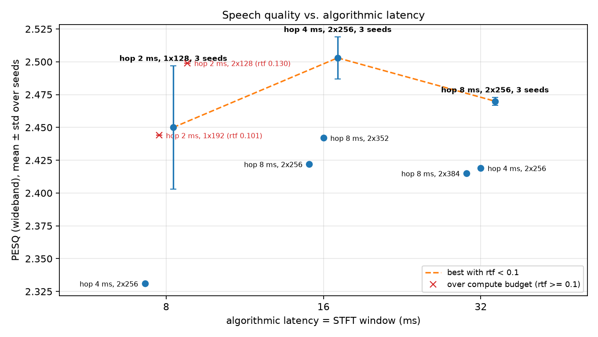

# How much PESQ does each ms of algorithmic latency cost? Causal GRU mask, VoiceBank-DEMAND, rtf < 0.1

## Question
For algorithmic latency budgets of 8, 16 and 32 ms (n_fft 128/256/512 at 16 kHz), which hop / GRU width / depth gives the best wideband PESQ while keeping rtf < 0.1 (one CPU thread, batch 1)? And how much PESQ does each millisecond of latency cost?

## Answer
| Budget | Best config with rtf < 0.1 | Seeds | PESQ (mean ± std) | STOI | SI-SDR (dB) | rtf |
|---|---|---|---|---|---|---|
| 8 ms | n_fft 128, hop 32, hidden 128, **1 layer** | 3 | **2.450 ± 0.047** | 0.932 | 17.48 | 0.070–0.079 |
| 16 ms | n_fft 256, hop 64, hidden 256, 2 layers | 3 | **2.503 ± 0.016** | 0.936 | 18.60 | 0.089–0.097 |
| 32 ms | n_fft 512, hop 128, hidden 256, 2 layers (default) | 3 | **2.470 ± 0.003** | 0.934 | 18.82 | 0.042–0.051 |

(Noisy input: PESQ 1.97, STOI 0.921, SI-SDR 8.4 dB.)

- **8 → 16 ms:** +0.053 PESQ, about **0.007 PESQ per ms**. This is only suggestive. The 8 ms seeds vary a lot (2.40 / 2.45 / 2.50), so the gap is about 1.9 pooled standard errors with n = 3. It is not a confirmed difference.
- **16 → 32 ms:** no gain; 32 ms is 0.033 *lower*. This holds on every seed: the worst 16 ms seed (2.485) beats the best 32 ms seed (2.472). Within the 32 ms configs tried, the extra 16 ms buys no PESQ.
- **SI-SDR (the training loss) does rise with latency:** 17.5 → 18.6 → 18.8 dB. Longer windows help the loss, but that doesn't reach PESQ beyond 16 ms.
- **Short version:** the cost of latency is small. All three budgets fall within about 0.05 PESQ. Most of the curve is decided by how small a hop you can afford, not by the window length.

## What was tried and why
| Run | Latency | Change | Seeds | PESQ | rtf | Takeaway |
|---|---|---|---|---|---|---|
| ref-w512-h128 | 32 | default | 3 | 2.470 ± 0.003 | 0.05 | reference |
| w512-h64-hid256 | 32 | hop 64 | 1 | 2.419 | 0.095 | smaller hop did not help at 32 ms (one seed; 2nd seed preempted) |
| w512-h128-hid384 | 32 | wider | 1 | 2.415 | 0.073 | width did not help |
| w256-h64-hid256 | 16 | 75% overlap | 3 | 2.503 ± 0.016 | 0.09–0.097 | best at 16 ms |
| w256-h128-hid256 | 16 | 50% overlap | 1 | 2.422 | 0.043 | −0.08 vs hop 64 |
| w256-h128-hid352 | 16 | 50% overlap, wider | 1 | 2.442 | 0.064 | width recovers ≤0.02 |
| w128-h64-hid256 | 8 | 50% overlap | 1 | 2.331 | 0.093 | hop 64 (4 ms hop) is poor at 8 ms |
| w128-h32-hid128 (2 layers) | 8 | 75% overlap | 1 | 2.499 | **0.130 ✗** | good quality, over the budget |
| w128-h32-hid128-L1 | 8 | 75% overlap, 1 layer | 3 | 2.450 ± 0.047 | 0.07–0.08 | best feasible at 8 ms |
| w128-h32-hid192-L1 | 8 | wider 1-layer | 1 | 2.444 | **0.1005 ✗** | just over budget, no gain |

## What limits quality at low latency
1. **Hop size (frame rate), more than window length.** Smaller hops helped on every budget except 32 ms. At 16 ms, hop 64 beat hop 128 by 0.08. At 8 ms, hop 32 beat hop 64 by 0.12 (mean of 3 vs a single run). Both alternatives are single-seed, but the gaps are well above the 0.05 noise level. GRU width barely mattered anywhere (±0.02–0.05, within noise).
2. **Fixed per-frame and per-layer compute overhead.** Fitting the measured times gives ms/hop ≈ 0.02 + layers × (0.105 + 1e-6·hidden²). Each GRU layer costs about 0.1 ms per frame regardless of width, so narrowing the model saves little. At a 2 ms hop (budget 0.2 ms), two layers cannot fit at any width, so the 8 ms model must drop to one layer. On one seed the 2-layer hop-32 model reached 2.499, close to the 16 ms result, but it ran at rtf 0.13. **At 8 ms, compute overhead is the bottleneck, not spectral resolution.**
3. Frequency resolution (65 bins at 8 ms) probably explains the about 1.1 dB SI-SDR drop. Its effect on PESQ is small next to the hop effect.

## Caveats
- rtf varies about ±10% between identical configs (the reference ran at 0.042–0.051). The 16 ms winner (0.089–0.097) has little margin and could exceed 0.1 on the target device.
- The 8 ms result has a large seed spread (std 0.047). The 32 ms alternatives (hop 64, hidden 384) have only one seed each.
- Every run used the same training recipe (10k steps). Larger-context models may be under-trained, which could explain why 32 ms does not beat 16 ms.

## Failures and diagnosis
All 5 failures were infrastructure problems; none came from a config:
- 4 launches failed before training with `Modal ResourceExhaustedError: App create rate limit exceeded`. This seemed to happen when 4 runs were launched together. All were relaunched unchanged and later finished, with one exception below.
- `w512-h64-hid256-s1` was preempted at step 2150 (`Input aborted due to internal failure (e.g. preemption)`); its loss was still improving normally. It was not relaunched: the last launch went to a third 8 ms seed, which matters more for the answer.
- These failures used up 5 of the 20 launches.

## What I would try next
1. **Cut the per-layer overhead** (fused or exported GRU inference, e.g. ONNX / a hand-fused 2-layer step) so the 2-layer hop-32 model (2.499 on one seed) fits at 8 ms. This is the biggest likely gain at low latency.
2. More seeds at 8 ms (std 0.047) to pin down the 8 vs 16 ms gap, and a second seed for 32 ms hop 64.
3. Longer training or a lower learning rate for the 32 ms models, to check whether "no gain past 16 ms" is a training-budget artefact.
4. Measure rtf on the actual target device, and repeat each measurement several times, before deploying the 16 ms config at rtf ≈ 0.095.
5. A loss closer to perceptual quality (e.g. SI-SDR + multi-resolution spectral loss), since SI-SDR gains at 32 ms did not carry over to PESQ.

