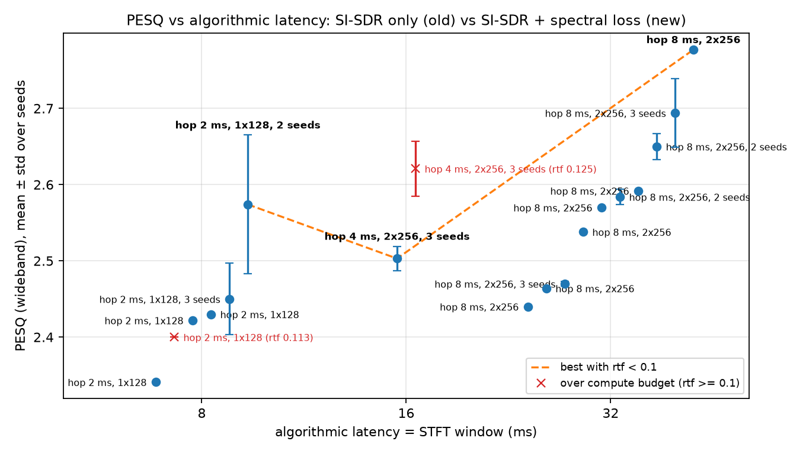

# Training-only recipe for the causal GRU enhancer: a spectral loss raises the PESQ–latency front

## Question
Can training-only changes raise the PESQ–latency Pareto front without changing inference cost? Each budget keeps its architecture (n_fft, hop, hidden, layers); only the training changes. Candidates tested: `spec_weight` (compressed multi-resolution spectral loss added to SI-SDR), `feature='pow0.3'`, `lr_schedule='cosine'`, and more `steps`.

Old front (SI-SDR loss only, 3 seeds): 8 ms 2.450, 16 ms 2.503, 32 ms 2.470.

## Answer (short)
**Add the spectral loss with a large weight (`spec_weight=400`).** For the small 8 ms model, also **train for 30k steps**.

| Budget | Architecture (unchanged) | Old PESQ (3 seeds) | New recipe | New PESQ | Seeds | ΔPESQ | SI-SDR old → new | STOI old → new |
|---|---|---|---|---|---|---|---|---|
| 8 ms | n_fft 128 / hop 32 / hid 128 / L1 | 2.450 ± 0.047 | sw400 + 30k steps | **2.574 ± 0.091** | 2 (1 lost to preemption) | +0.12 (indicative) | 17.48 → 16.89 dB | 0.932 → 0.937 |
| 16 ms | n_fft 256 / hop 64 / hid 256 / L2 | 2.503 ± 0.016 | sw400 | **2.621 ± 0.036** | 3 | **+0.12** | 18.60 → 18.14 dB | 0.936 → 0.939 |
| 32 ms | n_fft 512 / hop 128 / hid 256 / L2 | 2.470 ± 0.003 | sw400 | **2.694 ± 0.045** | 3 | **+0.22** | 18.82 → 18.69 dB | 0.934 → 0.940 |

- **32 ms and 16 ms:** the gain is confirmed. Every new seed beats every old seed.
- **8 ms:** the gain is likely but less certain. Only 2 seeds finished (2.638 and 2.510), with a large spread.
- **SI-SDR cost:** small at 32 ms (−0.13 dB), and about −0.5 to −0.6 dB at 16 and 8 ms. PESQ and STOI go up while SI-SDR goes down. This is the expected effect of moving loss weight from SI-SDR to the spectral term.

**How to read the plot's auto front.** The front the tool draws is *not* the confirmed front above, for two reasons:
- At 32 ms it picks `spec_weight=1000` (2.777), which is a **single seed**.
- At 16 ms it falls back to the old config, because the tool scores the sw400 group by its worst measured rtf (0.125, from one run). See the rtf note below.

## What was tried and why
All exploration was on the 32 ms default unless stated. The old baseline is 2.470.

| Run | Hypothesis | PESQ | SI-SDR | Verdict |
|---|---|---|---|---|
| sw5 | spectral loss fixes artifacts SI-SDR ignores | 2.440 | 18.75 | no effect at low weight |
| sw20 | dose-response | 2.538 | 18.69 | + |
| sw50 (2 seeds) | dose-response | 2.584 ± 0.010 | 18.86 | +0.11, real |
| sw150 (2 seeds) | still rising? | 2.650 ± 0.017 | 18.78 | +0.18, real |
| **sw400 (3 seeds)** | still rising? | **2.694 ± 0.045** | 18.69 | **+0.22, chosen** |
| sw1000 (1 seed) | upper bracket | 2.777 | 18.57 | maybe higher; unconfirmed, SI-SDR starting to drop |
| pow0.3 | better-conditioned input | 2.464 | 18.57 | no effect |
| sw50 + cosine | settle into a better minimum | 2.570 | 18.79 | no gain over sw50 |
| sw50 + 20k steps | undertrained? | 2.592 | 18.76 | no gain over sw50 (big model) |

The suggested weight range (5–50) was too low. PESQ kept rising up to at least 400 with almost no SI-SDR cost on the 32 ms model.

**Transfer to 8 ms.** The recipe did *not* transfer directly at 10k steps:

| 8 ms run | PESQ | SI-SDR |
|---|---|---|
| sw50 | 2.341 | 17.23 |
| sw150 | 2.400 | 17.04 |
| sw400 | 2.430 | 16.68 |

All three are within noise of the old 2.450 ± 0.047, and SI-SDR dropped. My hypothesis was that the 116k-param model fits the combined loss more slowly. Tripling the steps tested this:

| 8 ms run (30k steps) | PESQ | SI-SDR |
|---|---|---|
| sw400 + 30k, s0 | 2.638 | — |
| sw400 + 30k, s2 | 2.510 | — |
| sw0 + 30k, ablation, 1 seed | 2.422 | 17.73 |

The ablation suggests steps alone do not help. The gain needs the spectral loss *and* the longer schedule together. That attribution rests on a single seed.

## Failures and diagnosis
- **Two runs aborted by infrastructure:** `w128-...-sw400-30k-s1` at step 28,950/30,000 and `w256-h64-sw400-30k-s0` at step 23,350.
  - Logs: `modal.exception.RemoteError: Input aborted due to internal failure (e.g. preemption). Retries are disabled`.
  - The training loss was normal right up to the abort, so this was preemption, not a config or code problem.
  - The budget was used up, so neither could be relaunched. As a result, the 8 ms recipe has 2 seeds instead of 3, and there is no result on whether 30k steps also help the 16 ms model.
- **rtf measurement noise:** two runs went over 0.1 although their architecture and parameter count are identical to runs that passed.

  | Run | Measured rtf | Same architecture elsewhere |
  |---|---|---|
  | 8 ms sw150 | 0.113 | 0.070–0.085 in 6 other runs |
  | 16 ms sw400 s1 | 0.125 | 0.093 and 0.095 in its sibling seeds |

  Identical 32 ms models also ranged from 0.042 to 0.063. My diagnosis is CPU contention from 4 jobs running at once during the single-thread timing. The training changes cannot change inference cost.
  - **Caveat:** the 16 ms architecture already sits at about 0.09–0.097 even in clean measurements. It has little headroom against the 0.1 budget on the target device, whatever the training recipe.

## Recommendations and open items
1. Adopt `spec_weight=400` for all budgets, plus `steps=30000` for the 8 ms model.
2. Run a third seed of the 8 ms recipe to confirm the +0.12 (current spread ± 0.09).
3. Test `spec_weight=1000` with 3 seeds at 32 ms. One seed gave 2.777, and the optimum may lie above 400 if the extra SI-SDR loss (−0.25 dB) is acceptable.
4. Test 30k steps at 16 ms with sw400 (the run was lost to preemption).
5. Re-time the 16 ms architecture on an idle machine to confirm it stays under rtf 0.1.

